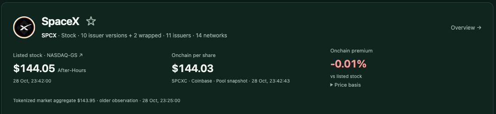

# Stocklens

**One stock. Compare its tokens.**

The same stock can have several tokenized versions, each with a different ticker, issuer and network. Stocklens brings them together so you can compare your options before choosing where to buy.

**[Try Stocklens →](https://stocklens-osft.onrender.com)** · [Explore Markets](https://stocklens-osft.onrender.com/?page=markets)

## How it works

1. **Search a stock**, such as NVIDIA, Apple or Tesla.
2. **Compare its tokenized versions** by issuer, network, price, liquidity and product terms.
3. **Enter an amount** to compare supported buy quotes and see how much equivalent stock exposure each offers.
4. **Open the venue** to review its latest quote and access requirements.

No account or wallet connection is needed to explore Stocklens. Purchases happen on the venue you choose.

## Explore the market

The **Markets** page puts tokenized stocks and ETFs in one searchable view. Browse prices, trading volume, networks and available versions, alongside onchain premiums, company market caps and P/E ratios where data is available.

Open a stock for its price history, issuers, networks and contracts. Select up to five stocks for a side-by-side market comparison, or compare token versions of the same stock. Save assets to your watchlist and filter by issuer or network.

## Explore issuers

The **[Issuers](https://stocklens-osft.onrender.com/?page=issuers)** page compares reported token market caps, market share, trading volume and asset coverage. Open an issuer for its mapped securities, networks and product terms, then continue straight into Compare.

Source dates and reporting coverage stay visible. Market share uses the reported caps available for the tracked issuers; it is not a claim of complete global coverage.

## Methodology

- **Coverage.** The catalog counts mapped assets. The priced count covers distinct assets with a positive tokenized price in the market pages loaded so far. Pre-IPO entries have a separate filter.
- **Prices.** CoinGecko market observations are separate from size-specific buy quotes. Nasdaq supplies listed references where the identity matches. When the reference is the last close, the comparison shows the gap between the onchain price and the listed close.
- **Buy depth.** Test 100, 1,000, 10,000 and 100,000 USDC on one contract and network. Report the largest tested order whose quoted cost per equivalent share is at most 1% above the 100 USDC quote. Quotes exclude gas and expire. A small-order quote can itself be expensive.
- **Terms and market share.** Terms link to issuer disclosures. Jurisdiction and redemption rules can depend on the venue and investor. Issuer shares use available reported token caps for the tracked universe.
- **Usage and history.** First-party aggregate counts cover selected catalog assets and quote venue clicks, without retaining search text, wallet addresses, cookies or visitor IDs in the analytics. The app honors Global Privacy Control and Do Not Track. The archive records observations as they arrive, with original timestamps.

The source code is available under the [MIT License](LICENSE). Third-party data, logos and trademarks remain subject to their respective terms.

## Work in progress

Stocklens is a public portfolio project under active development. Coverage varies by asset and provider. Missing data and older observations are labeled in the app.

Buy comparisons use verified share conversions where available. Quotes expire, and gas, bridging and other separate costs are excluded from the comparison.

---

Building from source? See the [development guide](DEVELOPMENT.md) and [deployment instructions](DEPLOY.md).
